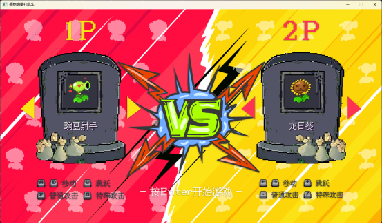
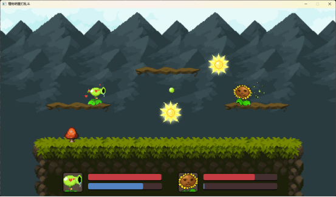

# 植物明星打乱斗

一款基于 **C++** 与 **EasyX** 图形库开发的本地双人横版格斗小游戏。玩家可选择豌豆射手、龙日葵、大喷菇三位植物角色，在平台地图上利用普通攻击与必杀技进行对战，将对手血量清零或击落屏幕外即可获胜。





---

## 目录

- [游戏特色](#游戏特色)
- [环境要求](#环境要求)
- [编译与运行](#编译与运行)
- [操作说明](#操作说明)
- [角色介绍](#角色介绍)
- [游戏机制](#游戏机制)
- [项目结构](#项目结构)

---

## 游戏特色

- 🎮 本地双人对战，同屏竞技
- 🌱 三位风格各异的植物角色，各自拥有独特的普通攻击与必杀技
- 💥 帧动画、粒子特效、屏幕震动、无敌帧闪烁等丰富的战斗表现
- 🎵 背景音乐与音效（攻击、命中、UI 反馈）
- 📊 实时血条与能量条显示
- 🛠️ 内置调试模式（F1 切换），可显示碰撞框

---

## 环境要求

| 项目 | 要求 |
|------|------|
| 操作系统 | Windows 10/11 |
| 编译器 | Visual Studio 2022（v143 工具集） |
| 图形库 | [EasyX Graphics Library](https://easyx.cn/) for C++ |
| Windows SDK | 10.0 |
| 字符集 | Unicode |

> 项目使用 `#include <graphics.h>`（EasyX 接口）以及 `Winmm.lib` / `MSIMG32.LIB`。请确保已安装 EasyX 并在 Visual Studio 中正确配置了其头文件与库目录。

---

## 编译与运行

1. 安装 [EasyX](https://easyx.cn/) 图形库。
2. 用 Visual Studio 2022 打开解决方案 [植物明星打乱斗.sln](植物明星打乱斗.sln)。
3. 选择 `Release` 或 `Debug` 配置（支持 x86 / x64）。
4. 生成并运行 `植物明星打乱斗` 项目。
5. 进入主菜单后按任意键开始游戏。

> 运行时请确保 `植物明星打乱斗/resources/` 目录下的图片、音频、字体资源与可执行文件在同一工作目录中（项目已配置为从相对路径 `resources/` 加载资源）。

---

## 操作说明

### 主菜单

- **任意键**：进入角色选择界面

### 角色选择界面

| 操作 | 玩家 1 (1P) | 玩家 2 (2P) |
|------|-------------|-------------|
| 切换左一个角色 | `A` | `←` |
| 切换右一个角色 | `D` | `→` |
| 确认并开始对战 | `Enter` | `Enter` |

### 对战界面

| 操作 | 玩家 1 (1P) | 玩家 2 (2P) |
|------|-------------|-------------|
| 向左移动 | `A` | `←` |
| 向右移动 | `D` | `→` |
| 跳跃 | `W` | `↑` |
| 普通攻击 | `F` | `.` |
| 必杀技（需满能量） | `G` | `/` |
| 切换调试模式 | `F1` | `F1` |

---

## 角色介绍

游戏内共有三位可选角色，每位角色初始生命值为 **100**，通过命中敌人积累 **能量（MP）**，能量满 100 后可释放必杀技。

### 🌿 豌豆射手

- **普通攻击**：向前发射一颗豌豆，造成 **10** 点伤害，命中回复 25 点能量。
- **必杀技「豌豆风暴」**：在 2.5 秒内持续高速发射豌豆（伤害 10 / 发），期间伴随屏幕震动。
- **特点**：射速快、弹道平直，擅长中远距离压制。

### 🌻 龙日葵

- **普通攻击**：抛出一颗日光炸弹（抛物线轨迹），命中后爆炸造成 **15** 点伤害，回复 35 点能量。
- **必杀技「陨日」**：在对手头顶召唤一颗巨型日光炸弹垂直落下，爆炸造成 **20** 点伤害并触发强烈屏幕震动。
- **特点**：范围大、爆发高，必杀技难以躲避但需要预判。

### 🍄 大喷菇

- **普通攻击**：在身体周围释放大范围气泡，命中造成 **10** 点伤害，回复 35 点能量。
- **特点**：近战范围型角色，攻击判定区域大，适合贴身缠斗。

---

## 游戏机制

- **生命值（HP）**：初始 100，归零即判负。被击落屏幕外也会直接判负。
- **能量（MP）**：通过命中敌人获得，满 100 可释放必杀技。
- **无敌帧**：受到伤害后进入短暂无敌状态（750ms），期间角色以剪影闪烁表现，避免连击秒杀。
- **平台系统**：场景包含 1 个大平台与 3 个小平台，玩家可在平台间跳跃移动。
- **物理系统**：包含重力、跳跃速度、跑动速度与平台碰撞检测。
- **摄像机**：跟随玩家移动，攻击命中时产生屏幕震动以增强打击感。

---

## 项目结构

```
植物明星打乱斗/
├── 植物明星打乱斗.sln              # Visual Studio 解决方案
├── 植物明星打乱斗/                  # 主项目
│   ├── 植物明星打乱斗.cpp          # 程序入口、资源加载、主循环
│   ├── 植物明星打乱斗.vcxproj      # 项目配置文件
│   ├── scene.h                    # 场景基类
│   ├── scene_manager.h            # 场景管理器（菜单/选角/对战）
│   ├── menu_scene.h               # 主菜单场景
│   ├── selector_scene.h           # 角色选择场景
│   ├── game_scene.h               # 对战场景
│   ├── player.h                   # 玩家基类（移动/跳跃/碰撞/输入）
│   ├── peashooter_player.h        # 豌豆射手
│   ├── sunflower_player.h         # 龙日葵
│   ├── gloomshroom_player.h       # 大喷菇
│   ├── bullet.h                   # 子弹基类
│   ├── pea_bullet.h               # 豌豆子弹
│   ├── sun_bullet.h / sun_bullet_ex.h  # 日光炸弹 / 巨型日光炸弹
│   ├── bubbles_bullet.h           # 气泡子弹
│   ├── status_bar.h               # 血条/能量条 UI
│   ├── camera.h                   # 摄像机与屏幕震动
│   ├── platform.h                 # 平台
│   ├── animation.h / atlas.h      # 动画与图集
│   ├── particle.h                 # 粒子特效
│   ├── timer.h                    # 定时器
│   ├── vector2.h                  # 二维向量
│   ├── util.h                     # 工具函数（图片翻转/Alpha混合等）
│   └── resources/                 # 图片、音频、字体资源
├── 植物明星大乱斗1.0/              # 安装包部署项目
└── msg/                           # 演示截图
    ├── 选择界面.png
    └── 游戏界面.png
```

---

## 许可声明

本项目仅供学习交流使用。角色与美术素材的版权归原作者所有。
